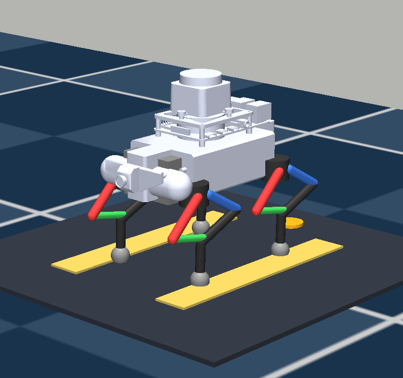
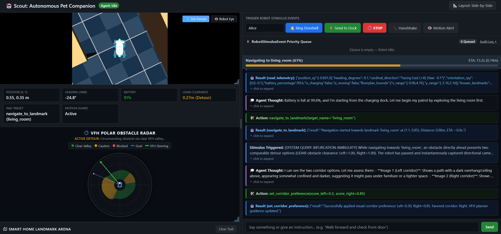

# Autonomous Pet Companion: AI Agent & Social Robot Digital Twin

<p align="center">
  
</p>

<p align="center">
  
  <br/>
  <em>Scout Mission Control dashboard featuring real-time camera streams, 2D floorplan tracking with interactive landmark dispatch, stimulus controls, and live cognitive reasoning feed.</em>
</p>

An AI-driven quadruped robot companion built for domestic human-robot interaction, natural conversation, and autonomous home navigation.

The goal of this project is to give a **multimodal AI agent physical agency in the real world**. Operating like an inquisitive, loyal pet, the agent explores its home environment, follows its owner, greets visitors at the front door, speaks aloud, and navigates smoothly between domestic landmarks.

> [!NOTE]
> **Disclaimer**: This is a personal project. The views, code, and opinions expressed here are my own and do not represent those of my current or past employers.

> [!TIP]
> **Attribution & Reference Sources**  
> This repository builds on work from official and open-source community contributors:
> - **3D STL Meshes & SolidWorks Models**: Sourced from Arnau Crespí's community CAD repository: [arnaucresp0/WAVEGO_3D_MODEL](https://github.com/arnaucresp0/WAVEGO_3D_MODEL).
> - **Official Kinematics & Firmware**: Waveshare's official open-source repository: [waveshareteam/WAVEGO_Pro](https://github.com/waveshareteam/WAVEGO_Pro).
> 
> Our [`wavego_kinematics.py`](wavego_kinematics.py) is a standalone Python port of Waveshare's official `BodyCtrl.cpp` / `BodyCtrl.h` closed-form inverse kinematics and crawl/trot gaits.

---

## 🌟 The Big Picture: Social AI Companion

This project is about **human-robot companionship**. Locomotion and obstacle avoidance are simply tools that enable the agent to interact naturally with people in a home:

- **🐶 Pet-Like Autonomous Persona**: When idle, the agent explores room to room, inspects its surroundings with its camera and LiDAR, and talks to itself. If it sees a human, it treats them as its owner and follows them around; if it loses sight of them, it can ask aloud *"Where are you?"*.
- **🗣️ Voice & Multimodal Vision**: The agent speaks out loud to the room (`announce_message`), observes the world through an eye-level ultra-wide camera (`capture_camera_image`), and performs expressive gestures like greeting paw waves (`perform_handshake`).
- **⚡ Home Grounding**: Knows home landmarks (`charging_dock`, `front_door`, `living_room`, `kitchen`), responds to smart home doorbell rings, and docks autonomously when low on battery.

---

## 🧭 Navigation Architecture: VFH with Agentic Visual Override

A key challenge in autonomous robotics is balancing **fast, reactive obstacle avoidance** with **high-level semantic reasoning**. If an LLM had to decide every footstep, navigation would be sluggish and fragile. If navigation were purely reactive, the robot would be blind to semantic context.

We solve this with a hybrid **Vector Field Histogram (VFH) + Cognitive Override** architecture:

```
[ Goal: e.g. "kitchen" ]
         │
         ▼
 ┌────────────────────────────────────────────────────────┐
 │ 1. Reactive VFH Planner (Continuous 360° LiDAR)        │
 │    - Sweeps 360° LiDAR rays & builds polar obstacle map│
 │    - Identifies open directional valleys               │
 │    - Evaluates path costs (goal alignment + steering)  │
 └──────────────────────────┬─────────────────────────────┘
                            │
            Path clear? ────┴──── Equal divergence (>= 60°)?
            │                                   │
            ▼ (Smooth & direct)                 ▼ (Bifurcation Ambiguity)
   [ Steer through valley ]         ┌───────────────────────────────────────┐
                                    │ 2. Agentic Visual Disambiguation      │
                                    │    - Front wide-angle camera captures │
                                    │      simultaneous Left & Right views  │
                                    │    - Prompts multimodal AI Agent:    │
                                    │      "Which path is better?"          │
                                    │    - Agent injects visual bias term   │
                                    │      into VFH cost function           │
                                    └───────────────────┬───────────────────┘
                                                        │
                                                        ▼
                                           [ Steer toward favored path ]
```

### 1. Agent-Less VFH Navigation (Reactive & Fast)
Most of the time, the agent does **not** micromanage movement. When dispatched to a landmark (`navigate_to_landmark`), the robot uses an authentic **Vector Field Histogram (VFH)** planner:
- Sweeps a continuous 360° DTOF LiDAR scan to generate a polar obstacle density histogram.
- Enforces physical robot footprint clearance margins to keep the chassis and legs safe.
- Groups clear bins into navigable valleys and steers toward the lowest-cost trajectory toward the goal.
- Smoothly avoids walls, furniture, and unexpected clutter at full walking speed.

### 2. Cognitive Bifurcation Disambiguation (Agentic Override)
Reactive planners struggle when encountering large, symmetric obstacles (e.g. A dining table, media console, or central pillar) that present two equally viable detour paths.

When the VFH planner detects:
1. Clearance scores on both flanks are balanced,
2. The most prominent Left path and most prominent Right path have competitive navigation costs, AND
3. The angular separation between the two choices is significant (**divergence $\ge 60^\circ$**),

it flags a **Bifurcation Ambiguity**. Rather than guessing blindly or oscillating:
- The robot halts safely.
- Its front ultra-wide camera ($>160^\circ$ FOV) instantaneously extracts dual Left and Right perspective views with zero mechanical head movement.
- The system prompts the multimodal AI Agent with both images to evaluate semantic traversability (e.g., *"Left corridor is blocked by cables; right corridor leads directly toward the open kitchen"*).
- The agent scores each flank, applying a directional bias to the VFH cost function that smoothly decays over time as the robot rounds the obstacle.

---

## 🏛️ System Architecture

```
robot/
├── app/
│   ├── agent.py            # Multimodal AI Agent (Google ADK + OpenRouter Vision)
│   ├── tools.py            # Typed agent tools (navigation, vision, speech, gestures, dock)
│   ├── vfh_planner.py      # Real-time VFH obstacle avoidance & bifurcation detector
│   ├── action_manager.py   # Asynchronous navigation worker, odometry & stall detection
│   ├── gateway.py          # FastAPI web server, SSE event stream & priority event queue
│   ├── config.py           # Configuration (landmarks, models, speeds, thresholds)
│   └── templates/
│       └── dashboard.html  # Mission Control Web Dashboard (dual cameras, 2D map, live feed)
│
├── sim.py                  # Physics digital twin in MuJoCo (360° LiDAR, cameras, 12 servos)
├── kinematics.py           # Standalone quadruped kinematics & trot gait engine
├── robot_protocol.py       # Serial protocol definitions & command constants
├── main.py                 # Application entrypoint
└── demo.py                 # Interactive 3D visualizer script for manual evaluation
```

---

## 🚀 Quickstart

### 1. Environment Setup
Manage dependencies using [`uv`](https://github.com/astral-sh/uv):

```bash
# Sync virtual environment
uv sync

# Configure your OpenRouter API key
echo "OPENROUTER_API_KEY=your_key_here" > .env
```

### 2. Launch the Robot & Mission Control
Start the robot simulation, VFH planner, cognitive gateway, and web dashboard:
```bash
uv run python main.py
```

### 3. Open Mission Control
Open your browser to:
```
http://localhost:8000/
```

- **👁️ Robot Eye & 🌐 3rd-Person Cameras**: Stream real-time first-person fisheye video or overhead spectator views.
- **🗺️ Interactive 2D Floorplan**: Real-time odometry trail and click-to-navigate landmarks (⚡ **Dock**, 🚪 **Front Door**, 🛋️ **Living Room**, 🍳 **Kitchen**).
- **🔔 Stimulus Controls**: Ring the front doorbell, dispatch the robot to its dock, or chat directly with the agent.
- **💭 Live Cognition Feed**: Inspect the AI agent's internal thoughts, tool calls, and spoken announcements in real time.

---

## 🎮 Standalone Interactive Demo

To test gaits, LiDAR scans, and keyboard teleoperation directly in the native 3D MuJoCo window:
```bash
uv run python demo.py
```
